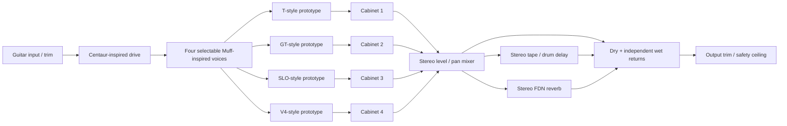

# HeavyAmpSim

A Windows-first C++17 / JUCE VST3 project for a four-amplifier doom, stoner and
desert rock rig. **Version 0.1 is a working routing/DSP prototype, not yet a
schematic-accurate recreation of the requested hardware.**

Windows downloads are published as experimental prereleases after GitHub's
Windows build and tests pass: [Releases](https://github.com/VerdilacSound/HeavyAmpSim/releases).
Choose `HeavyAmpSim-Windows-x64-Release-VST3.zip` and preserve the bundle when
extracting it. Matching application/dependency source archives and checksums
accompany each binary. A release appears only after its workflow succeeds.

## Signal path



The shared pedalboard runs once before the split. Four independent nonlinear
states and cabinet FIRs then feed a constant-power stereo mixer. The effect
returns are **additive sends**: zero return is dry, maximum adds unity wet to
unchanged dry. Delay never feeds reverb, and neither effect feeds the other.
Mono input is preferred; stereo input is explicitly averaged before the pedals.
Stereo remains intact after the mixer. Each lane's level and pan are in its tab.

## Build on Windows

Install Visual Studio 2022 with **Desktop development with C++**, the Windows SDK,
CMake 3.22+ and Git. From a developer terminal at the repository root:

```powershell
cmake -S . -B build -A x64
cmake --build build --config Release --parallel 4
ctest --test-dir build -C Release --output-on-failure
```

JUCE 8.0.6 is fetched at a fixed commit. For an existing JUCE checkout, configure
with `-DJUCE_SOURCE_DIR=C:/path/to/JUCE` instead.

Outputs:

- `build/HeavyAmpSim_artefacts/Release/VST3/HeavyAmpSim.vst3` (copy the entire bundle
  into `C:\Program Files\Common Files\VST3` and rescan your DAW).
- `build/HeavyAmpSim_artefacts/Release/Standalone/HeavyAmpSim.exe` for a quick
  audio-device audition. Select your interface in its audio settings.

Use a mono guitar track with stereo output. By default only lane T has audible
level; raise the other lane levels to blend them. Double-click a slider to reset.
There is no bundled ASIO SDK; native ASIO integration is a later Windows task.
The Windows CI workflow builds/tests and uploads both formats when run on GitHub.
Adding the workflow file alone does not establish that a Windows build passed.

To build, run tests, verify the Windows x64 PE header, and create a ZIP in one
step, run this from PowerShell at the repository root:

```powershell
./scripts/build-windows.ps1
```

This creates `artifacts/HeavyAmpSim-Windows-x64-Release-VST3.zip` only after the
build and tests pass. The script requires Visual Studio 2022 C++ tools, CMake
and Git. The CI workflow uses the same script. A packaged binary still needs
real DAW validation before release.

## Core tests without JUCE or a GUI

```sh
cmake -S . -B build-core -DHEAVY_BUILD_PLUGIN=OFF -DCMAKE_BUILD_TYPE=Release
cmake --build build-core --parallel 4
ctest --test-dir build-core --output-on-failure
```

On GCC/Clang, `-DHEAVY_SANITIZERS=ON` enables AddressSanitizer and UBSan. Tests
exercise all four lanes, pan/mute/isolation, independent stereo effect inputs,
reverb decay, sample rates from 22.05 to 384 kHz, rapid control changes, extreme
levels, block-size invariance and heap-allocation-free core processing. When
JUCE is enabled, processor tests cover automation exposure, parameter recall,
audio callbacks and latency-preserving host bypass.

## Current implementation and limits

| Area | Implemented now | Required before release |
|---|---|---|
| Four amps | Distinct saturation stages, coupling, sag envelope, tone bands and presence; independent states | Circuit-derived models, original control sets, physical calibration and measured comparison |
| Pedals | Shared drive and four fuzz voicings; continuous bypass crossfades | Component-derived Centaur and revision-specific Muff models |
| Cabinets | Six original synthetic 256-tap FIR responses: four 4x12 voices, 8x10, 2x15; click-reduced selection | Licensed/measured long IRs, file import, mic positioning and phase validation |
| Mixer | Per-lane enable, gain, level, constant-power pan | Dedicated overview mixer, solo, polarity/time alignment |
| Delay | Independent stereo state, single-head, four-tap drum, low-wow studio tape voices | Hardware head patterns, compander/preamp/transport models and calibrated feedback |
| Reverb | Stereo-input 8-line orthogonal feedback network with damping/decay | Early-reflection geometry, diffusion/modulation tuning and perceptual validation |
| Quality | Fixed 4x FIR oversampling around all nonlinear stages, smoothed continuous controls, DC rejection, output ceiling | Alias/IMD budgets, true-peak protection, loudness matching, automation-transition and CPU profiling |
| Host integration | VST3/standalone targets, automatable stable IDs, XML state, 16-sample oversampling latency, bypass delay | Windows DAW matrix, validator runs, preset migration, packaging and signing |

Cabinet responses are synthetic, not captures of named cabinets. Amp and fuzz
names identify intended reference families, not verified circuit equivalence.
The reverb is algorithmic stereo; psychoacoustic accuracy has not been
established. The safety ceiling is not a true-peak limiter or mastering chain.
There is currently no input calibration wizard, tuner, gate, preset library or
user IR loader. No claim of a finished, mix-ready product is made for 0.1.

See [the design and validation plan](docs/DESIGN.md) for the hardware modeling
work that separates this prototype from the intended release.

## Dependencies and distribution

This project is licensed under [AGPL-3.0-only](LICENSE), including distribution
of the combined plugin under JUCE's AGPLv3 option. See
[third-party notices](THIRD_PARTY_NOTICES.md) for dependency licensing and source
availability. No third-party schematics, measured IR packs, hardware artwork or
branding assets are bundled.
